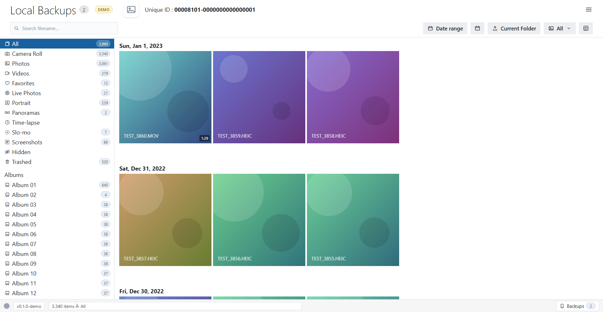

# BackupLens

> A lightweight, **local-only** web app to browse, preview and export photos and videos from
> **encrypted iPhone/iPad backups** made by iTunes, Finder or the Apple Devices app on Windows.

Version **0.1.0** · GPL-3.0-or-later · Python 3.11+ · no build step, no cloud, no telemetry.



*(Screenshots use the built-in synthetic demo library, not personal photos.)*

> **Independent project.** BackupLens is not affiliated with, endorsed by or sponsored by Apple.
> Use it only on backups of devices you own or are authorised to access. Installable packages for
> Windows, macOS and Linux will be published with the first release; running from source is supported now.

---

## 1. What it does

- Finds backups in the default Windows folders or any folder you add.
- Unlocks encrypted backups with **your** password (held only in memory for the session).
- Shows the photo library with the same sidebar/date-group layout as the reference UI:
  All · Camera Roll · Photos · Videos · Favorites · Live Photos · Portrait · Panoramas · Time-lapse ·
  Slo-mo · Screenshots · Hidden · Trashed · Albums · Moments.
- A virtualised, date-grouped grid that stays responsive with thousands of assets.
- Preview lightbox with keyboard navigation, zoom, video playback (HTTP Range), Live Photo clips and an
  info panel.
- **Unlimited export** to a folder: selected items, the current folder/scope, or everything; optional
  HEIC→JPEG, Live Photo videos, edited `.AAE` sidecars, four folder layouts, conflict policies, capture
  dates and an `export-report.txt`. A small-selection ZIP download is also available (≤500 items / 2 GB).
- Raw file explorer over the backup's `Manifest.db`: domains, folder tree, SQLite `LIKE` search with
  presets, sortable results, download and export matching/selected with relative paths preserved.
- Settings for theme, date-grouping zone, thumbnail size and the thumbnail/preview cache.

The backup folder is **never written to**. There are no accounts, uploads or outbound requests.

## 2. Quick start

```powershell
git clone <your-repo-url> backuplens
cd backuplens
python -m venv .venv
.venv\Scripts\activate
python -m pip install -r requirements.txt
python backend\app.py
```

The console prints a URL like `http://127.0.0.1:54321/?t=<token>` and opens your browser. Only
`127.0.0.1` is bound; the token URL is required. Pick a backup, enter its password, browse.

Optional demo without a backup: append `?mock=1` to the URL (or open `http://127.0.0.1:<port>/?mock=1`
without a token). It uses several thousand synthetic assets and self-contained SVG thumbnails.

Full setup, testing, privacy and packaging: **[project-docs/SETUP.md](project-docs/SETUP.md)**.

## 3. Download

Installables are published on the [latest release](https://github.com/tkrishnakanth/backuplens/releases/latest)
(draft releases are not public until the maintainer publishes them):

| OS | File | Notes |
|---|---|---|
| Windows 10/11 x64 | `BackupLens-<version>-windows-x64-setup.exe` | per-user install, no admin; portable ZIP also published |
| macOS Apple Silicon | `BackupLens-<version>-macos-arm64.dmg` | unsigned; Open Anyway required until notarized |
| macOS Intel | `BackupLens-<version>-macos-x86_64.dmg` | unsigned |
| Linux x86_64 | `BackupLens-<version>-linux-x86_64.AppImage` (also `.deb`, `.tar.gz`) | `chmod +x`; `libfuse2` may be needed |

Always verify `SHA256SUMS.txt` from the same release. Windows:
`Get-FileHash .\file.exe -Algorithm SHA256`; macOS: `shasum -a 256 file`; Linux: `sha256sum file`.
Unsigned builds trigger SmartScreen/Gatekeeper warnings; see [docs/INSTALL.md](docs/INSTALL.md) for the
exact flow. The app only listens on `127.0.0.1` and never needs an account.

## 4. Configuration

- `.env` (git-ignored) is used by the Phase 0 spike and integration tests only:
  ```
  BACKUP_PATH=C:\Users\YOU\Apple\MobileSync\Backup\DEMO-UDID-...
  BACKUP_PASSWORD=...
  ```
  The app itself asks for the password in the UI and never reads `.env`.
- User settings live in `%LOCALAPPDATA%\BackupLens\config.json`.
- The media cache lives in `%LOCALAPPDATA%\BackupLens\cache` by default (2 GB LRU, configurable).
  It is cleared on exit unless `CACHE_PERSIST` is enabled; **Settings → Clear cache** is always available.

## 5. Feature status (v0.1.0)

| Area | Status |
|---|---|
| Discovery, encrypted unlock, session close/purge | ✅ |
| Sidebar categories, albums, moments | ✅ reference parity verified against the owner's local-only acceptance file |
| Date-grouped virtualised grid, selection, type filter, calendar jump | ✅ |
| Lightbox, videos (Range), Live Photo clips, edited `.AAE` exposure | ✅ |
| Thumbnails, previews, cache, clear cache | ✅ |
| Unlimited folder export (all options), ZIP for small selections, report | ✅ |
| Raw file explorer (tree/search/sort/download/export) | ✅ |
| Settings (theme, grouping zone, thumbnail size, cache) | ✅ |
| Device info panel, in-app rich preview of arbitrary raw files | ⬜ P2 |
| Messages / chat apps / Contacts / Calls / Notes / Calendar / Safari / Voice / Apps | ⬜ P2/P3 (not in v0.1.0) |
| PyInstaller one-folder build | ✅ `scripts/build_exe.py` built and smoke-tested |

The complete matrix and acceptance evidence: `project-docs/FEATURES.md` · `project-docs/QA_REPORT.md`.

## 6. How it works

```
Browser (vanilla JS)  ⇄  Flask on 127.0.0.1  ⇄  single decrypt worker thread  ⇄  backup folder (read-only)
                              │
                              ├─ Photos.sqlite index (in memory)
                              ├─ thumbnail/preview cache (LRU)
                              └─ export jobs (atomic .part writes, cooperative cancel)
```

- `iphone_backup_decrypt` handles the keybag/PBKDF2/key-unwrap/AES. Its SQLite connection is thread-bound,
  so **every** library call goes through one worker thread. Metadata queries use separate read-only
  connections against a decrypted `Manifest.db` copy.
- Photos are grouped by the asset's iOS timezone offset (or this machine's zone).
- All network access is loopback; the token cookie is `HttpOnly`, `SameSite=Strict`, and Host/Origin are
  checked. CSP is `default-src 'self'; img-src 'self' data: blob:; media-src 'self' blob:`.

Design details, API and ADRs: [project-docs/ARCHITECTURE.md](project-docs/ARCHITECTURE.md).
Real database evidence: [project-docs/schema-notes.md](project-docs/schema-notes.md).

## 7. Tests

```powershell
pytest -q                       # unit + contract
pytest -q -m integration        # uses the real backup via BACKUP_PATH/BACKUP_PASSWORD
ruff check .
```

Current result: **106 unit/contract + 15 integration tests pass**; 20 exported files are byte-identical
to the decrypted originals; the real sidebar counts match the reference exactly. `pip-audit` reports no
known vulnerabilities. Full report: `project-docs/QA_REPORT.md`.

## 8. Privacy and safety

- Password: memory only, never logged, written or included in errors.
- Backup folder: read-only; every export destination is checked to be outside it.
- Decrypted temp data: removed when the session closes; media cache removed on exit by default.
- No CDN fonts/scripts, analytics, accounts or outbound requests.
- Use only on devices you own or are authorised to access.

## 9. Known limitations

- Photos stored only in iCloud (Optimize Storage) are not in a local backup.
- This backup format stores edited photos as `.AAE` adjustment sidecars; no rendered full-size edit exists.
  The export option copies the `.AAE`; the UI does not promise a rendered edit.
- Some browsers cannot decode HEVC/MOV; the lightbox then offers **Download original**.
- Raw file preview in-app (text/sqlite/plist) is not built in v0.1.0; files can be downloaded.
- Firefox/Edge and screen-reader audits are not automated in this environment (Chrome was verified).
- iOS releases can change `Photos.sqlite`; the code introspects the schema and fails soft, but brand-new
  variants may need a mapping update. Please open an issue with `project-docs/schema-notes.md` evidence.

## 10. Layout

```
backend/   app.py, backup/, photos/, media/, export/, files/, api/
frontend/  index.html, css/, js/ (vanilla ES modules), mock/
tests/     unit, contract, integration (gated)
docs/      public user guides and project screenshots
scripts/   build_exe.py
project-docs/   build process, architecture, features, UI spec, setup, prompt log, schema notes,
                and local-only raw data under project-docs/local/ (git-ignored)
```

## 11. Project documentation

The AI-assisted build process and the full design record live in **[project-docs/](project-docs/)**:

- [Architecture and ADRs](project-docs/ARCHITECTURE.md)
- [Feature matrix and acceptance evidence](project-docs/FEATURES.md)
- [UI specification](project-docs/UI_SPEC.md)
- [Developer setup](project-docs/SETUP.md)
- [Prompt log](project-docs/PROMPT_LOG.md)
- [Schema notes (sanitised)](project-docs/schema-notes.md) and [QA report](project-docs/QA_REPORT.md)

Raw schema samples, the owner's reference counts and the reference screenshot stay only in the
git-ignored `project-docs/local/` folder and are never published.

## 12. Credits and prior art

- `iphone_backup_decrypt` and the iOS backup reverse-engineering work it builds on.
- MaxiHuHe04/iTunes-Backup-Explorer (MIT) as a functional reference for the raw file explorer.
- iBackup Viewer as a **UI/feature reference only**; no assets, code or branding are reused.
- Licence texts and dependency compatibility: [project-docs/THIRD_PARTY.md](project-docs/THIRD_PARTY.md).

## 13. Licence

GPL-3.0-or-later — see [LICENSE](LICENSE). The project was relicensed from MIT in Phase 10 because the
official `pillow-heif` binary wheels bundle x265 (GPL-2.0-or-later); the source and binaries are now
distributed consistently under GPL-3.0-or-later. Third-party notices and source links are in
[THIRD_PARTY_NOTICES.txt](THIRD_PARTY_NOTICES.txt).
