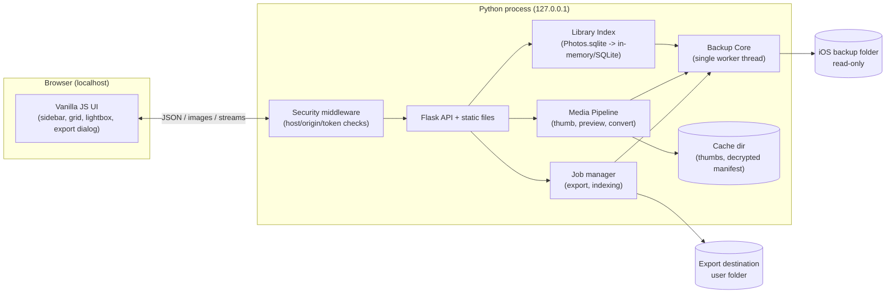

# ARCHITECTURE

Status: v1 design. The Architect agent owns this file; change it only through an ADR entry (§14).

---

## 1. Goals and non-goals

**Goals**
- Browse and export photos/videos from an **encrypted** local iOS backup on Windows.
- UI layout closely matches the reference screenshot (`project-docs/UI_SPEC.md`).
- Lightweight: small dependency set, fast start, low memory, smooth with 5,000+ assets.
- Local-only, read-only, privacy-preserving.
- Extensible to other data types (messages, contacts, notes, ...) without redesign.

**Non-goals (v1)**
- Restoring data to a device, editing/modifying backups, creating backups.
- iCloud backup download.
- Cloud hosting or multi-user access.
- Mobile layout (desktop browser only; responsive is a bonus).

## 2. Stack decision

| Layer | Choice | Reason |
|---|---|---|
| Language | Python 3.11+ | Mature decryption library exists; fastest path to a working, correct app |
| Web framework | Flask | Tiny, sync, easy to reason about |
| Server | Waitress | Pure-Python, production-grade, works on Windows |
| Decryption | `iphone_backup_decrypt` | Handles keybag, PBKDF2, key unwrap, per-file decrypt |
| Images | Pillow + pillow-heif | HEIC decode, thumbnail, JPEG conversion |
| Video thumbs | Backup's own pre-rendered thumbnails; optional `ffmpeg` if on PATH | No hard dependency |
| Frontend | Vanilla JS (ES modules) + CSS | No build step, tiny, matches "very lightweight" |
| Persistence | None by default; optional SQLite cache | Nothing sensitive stored unless the user opts in |

Alternative (Go) is parked in §13.

## 3. Background: how an iOS backup is laid out

- A backup is a folder named by the device UDID (e.g. `DEMO-UDID-00000001`).
- `Info.plist`: device name, product type/model, iOS version, last backup date, UDID.
- `Manifest.plist`: `IsEncrypted`, `BackupKeyBag`, `ManifestKey`, version info.
- `Manifest.db`: SQLite (encrypted as a whole when the backup is encrypted) with a `Files` table:
  `fileID` (SHA-1 hex), `domain`, `relativePath`, `flags` (1 = file, 2 = dir, 4 = symlink),
  `file` (binary plist with size, mode, timestamps, and for encrypted backups the wrapped
  per-file key and protection class).
- Payload files are stored as `<first two hex chars of fileID>/<fileID>` (no extension). When the
  backup is encrypted every payload file is AES-CBC encrypted with its own key.
- Photos live in domain `CameraRollDomain`:
  - Originals: `Media/DCIM/1xxAPPLE/IMG_nnnn.HEIC|JPG|MOV|PNG`
  - Metadata DB: `Media/PhotoData/Photos.sqlite` (albums, favorites, hidden, trashed, dates,
    moments, subtypes such as live/portrait/panorama/screenshot)
  - Pre-rendered thumbnails commonly under `Media/PhotoData/Thumbnails/...` (verify per backup)
- WhatsApp, Messages, Contacts etc. live in other domains (`AppDomainGroup-group.net.whatsapp.WhatsApp.shared`,
  `HomeDomain` for `Library/SMS/sms.db`, `Library/AddressBook/AddressBook.sqlitedb`, ...).

## 4. High-level architecture



### Components

| Component | Package | Responsibility |
|---|---|---|
| Discovery | `backend/backup/discovery.py` | Scan default Windows paths + user-added paths; read `Info.plist`/`Manifest.plist`; list backups |
| Unlock / Core | `backend/backup/core.py` | Wrap `iphone_backup_decrypt`; provide `list_files()`, `open_file_bytes()`, `extract_to_path()`; own the single worker thread |
| Manifest access | `backend/backup/manifest.py` | Read-only SQLite access to the decrypted `Manifest.db` copy; domain/path queries |
| Library Index | `backend/photos/` | Extract and open `Photos.sqlite`; build asset table, categories, albums, moments; count queries |
| Media Pipeline | `backend/media/` | Thumbnails (cache), previews, HEIC→JPEG, Range streaming for video |
| Export | `backend/export/` | Naming rules, de-duplication, ZIP streaming, folder export jobs with progress |
| API | `backend/api/` | Routes, validation, error model, security middleware |
| Frontend | `frontend/` | UI per `project-docs/UI_SPEC.md` |

## 5. Threading and concurrency model (important)

`iphone_backup_decrypt` keeps an internal SQLite connection that is bound to the thread that
created it. Flask/Waitress handle requests on many threads.

**Rule:** all calls into the decryption library go through **one dedicated worker thread**
(`concurrent.futures.ThreadPoolExecutor(max_workers=1)` or an explicit queue). Request threads
submit work and wait for the future. This avoids "SQLite objects created in a thread can only be
used in that same thread" errors without disabling thread checks.

Additional rules:
- Decrypt `Manifest.db` **once** per session to a temp file (the library exposes a public
  `save_manifest_file`) and open **separate read-only SQLite connections per request thread**
  for fast metadata queries (`file:...?mode=ro`, `uri=True`). Metadata browsing must never block
  on file decryption.
- Only actual file-content decryption is serialised through the worker. Thumbnails are therefore
  generated sequentially; mitigate with disk cache + prefetching of visible tiles first.
- If profiling in Phase 0 shows the library's per-file decrypt can safely be called from a pool
  (e.g. by vendoring the small decrypt routine with per-call connections), the Architect may
  raise `max_workers`. Record that decision as an ADR.
- Export jobs run on their own background thread and submit decrypt calls to the same worker,
  yielding so interactive thumbnail requests are not starved (small chunk size or priority queue:
  interactive > export).

## 6. Photos data model (Library Index)

### 6.1 Source of truth
`Media/PhotoData/Photos.sqlite` inside `CameraRollDomain`. Extract it (and its `-wal`/`-shm`
siblings if present in the backup) to the session cache dir, open read-only.

### 6.2 Schema variance — discover, do not assume
Table/column names differ by iOS version. Examples reported in the wild (to be **verified in Phase 0
against the real backup**, and recorded in `project-docs/schema-notes.md`):

- Asset table: `ZASSET` (newer) or `ZGENERICASSET` (older).
- Likely asset columns: `ZDIRECTORY`, `ZFILENAME`, `ZDATECREATED`, `ZADDEDDATE`, `ZKIND`
  (photo/video), `ZKINDSUBTYPE`, `ZFAVORITE`, `ZHIDDEN`, `ZTRASHEDSTATE`, `ZTRASHEDDATE`,
  `ZDURATION`, `ZWIDTH`, `ZHEIGHT`, `ZLATITUDE`, `ZLONGITUDE`, `ZPLAYBACKSTYLE`, `ZSAVEDASSETTYPE`,
  `ZDEPTHTYPE`, `ZISDETECTEDSCREENSHOT`.
- Original filename and size usually in `ZADDITIONALASSETATTRIBUTES` (`ZORIGINALFILENAME`,
  `ZORIGINALFILESIZE`) joined via the asset's foreign key.
- Albums: `ZGENERICALBUM` (title, kind) + a join table whose name contains the album/asset pair
  (e.g. `Z_26ASSETS`; the number changes with iOS version — locate via `sqlite_master`).
- Moments/places: `ZMOMENT` (title/subtitle/start/end dates) and/or reverse-geocode data on the
  additional attributes. The reference UI lists places (e.g. a locality name) alphabetically under
  "Moments".
- Timestamps are Core Data seconds since 2001-01-01 UTC; add 978307200 for Unix time.
- Commonly reported `ZKINDSUBTYPE` values (verify, do not trust): 0 normal, 1 panorama, 2 live
  photo, 10 screenshot-like, 100/101/102 high-frame-rate / slo-mo / time-lapse family.

**Implementation rule:** the Photos module must introspect with `PRAGMA table_info`, detect which
variant is present, map to a **normalised internal schema** (below), and fail soft (omit a category
and show a notice) if a column is missing. Never crash the app because a category cannot be derived.

### 6.3 Normalised internal schema (in-memory or small SQLite)

```
assets(
  id            TEXT PK        -- "a<Z_PK>"
  pk            INTEGER
  file_id       TEXT           -- Manifest fileID of the original
  rel_path      TEXT           -- Media/DCIM/100APPLE/IMG_0001.HEIC
  filename      TEXT           -- current filename
  original_name TEXT NULL
  kind          TEXT           -- 'photo' | 'video'
  taken_at      INTEGER        -- unix seconds (UTC)
  tz_offset     INTEGER NULL   -- if derivable, for correct local day grouping
  width, height INTEGER
  duration      REAL NULL
  size          INTEGER NULL
  favorite, hidden, trashed  INTEGER (0/1)
  is_live, is_portrait, is_panorama, is_timelapse, is_slomo, is_screenshot INTEGER (0/1)
  in_camera_roll INTEGER       -- lives under DCIM
  live_video_file_id TEXT NULL -- paired .MOV for Live Photos
  edited_file_id     TEXT NULL -- rendered edit if present
  thumb_file_id      TEXT NULL -- backup's own thumbnail if located
  lat, lon REAL NULL
)
albums(id, title, kind, count)           album_assets(album_id, asset_id)
moments(id, title, subtitle, start, end) moment_assets(moment_id, asset_id)
```

### 6.4 Categories (sidebar, in this order)
All · Camera Roll · Photos · Videos · Favorites · Live Photos · Portrait · Panoramas · Time-lapse ·
Slo-mo · Screenshots · Hidden · Trashed — then **Albums** (user albums, by title) — then
**Moments** (places, alphabetical).
Counts come from SQL on the normalised table. Zero counts render without a pill.

**Reference counts for the owner's original library** are kept in the local, git-ignored
`project-docs/local/reference-counts.json`. The public repository contains only the rules; integration
tests compare against the local file only when `BACKUPLENS_REFERENCE_COUNTS` is set.

### 6.5 Date grouping
Group by **local calendar day** of `taken_at` (use timezone offset if available, else the machine's
local zone; make it a setting). Header format: `Tue, Sep 10, 2024`. Sorted newest first by day;
within a day, newest first (match the reference).

## 7. API specification

All responses are JSON unless noted. Errors use `{ "error": { "code": "...", "message": "..." } }`
with proper HTTP status (400/401/403/404/409/500). IDs are opaque strings.

### 7.1 Backups and session
| Method | Path | Purpose |
|---|---|---|
| GET | `/api/backups` | Discovered + user-added backups: `{id, path, deviceName, productType, iosVersion, lastBackup, udid, encrypted, sizeBytes}` |
| POST | `/api/backups/add` | Add a custom backup folder path (validated) |
| POST | `/api/session/open` | Body `{backupId, password?}` → unlocks, builds index (async). 401 `wrong_password`, 409 `already_open` |
| GET | `/api/session` | Current session state: device info, `indexState: idle\|building\|ready\|failed`, progress |
| POST | `/api/session/close` | Zero the password, close DBs, optionally purge cache |

### 7.2 Library (photos)
| Method | Path | Purpose |
|---|---|---|
| GET | `/api/library/sidebar` | `{categories:[{key,label,count}], albums:[{id,title,count}], moments:[{id,title,count}]}` |
| GET | `/api/library/assets` | Query: `scope` (category key) or `album` or `moment`; `type=all\|photo\|video`; `from`,`to`; `q`; returns compact list sorted newest first (see 7.5) |
| GET | `/api/library/assets/{id}` | Full metadata + related files (live video, edited) |
| GET | `/api/media/{id}/thumb?size=320` | JPEG, cached; `Cache-Control` long; 404 if undecodable → UI shows placeholder |
| GET | `/api/media/{id}/preview` | Display-size JPEG (max ~2048 px) for photos; for video, the poster |
| GET | `/api/media/{id}/original` | Streams original with correct `Content-Type`, `Content-Disposition`, and HTTP Range support |
| GET | `/api/media/{id}/live` | Streams the paired Live Photo video |

### 7.3 Export
| Method | Path | Purpose |
|---|---|---|
| POST | `/api/export` | Body `{ids?:[], scope?:{...}, destination, options:{convertHeicToJpeg, includeLiveVideo, includeEdited, layout:'flat'\|'by-date'\|'by-album'\|'original-path', onConflict:'skip'\|'rename'\|'overwrite', setFileDates}}` → `{jobId}` |
| GET | `/api/jobs/{jobId}` | `{state, done, total, bytes, currentFile, errors[]}` (UI polls every 500 ms; SSE optional) |
| POST | `/api/jobs/{jobId}/cancel` | Cooperative cancel |
| POST | `/api/export/zip` | Body `{ids:[...]}` → streamed ZIP (store-only, no recompression). Cap size, warn above a threshold |
| POST | `/api/fs/pick-folder` | Optional: opens a native folder dialog (tkinter) and returns the path; fall back to a text field |

Destination must be validated: absolute path, writable, **not inside the backup folder**.

### 7.4 Raw file explorer (P1)
| Method | Path | Purpose |
|---|---|---|
| GET | `/api/files/domains` | Domains with counts |
| GET | `/api/files/tree?domain=&path=` | One level of a hierarchical view |
| GET | `/api/files/search?domain=&path=&sort=&dir=&limit=&cursor=` | SQLite `LIKE` search (`%`, `_`, `\` escape), like iTunes-Backup-Explorer's File Search |
| GET | `/api/files/{fileId}/download` | Decrypted raw file |
| POST | `/api/files/export` | Export matches or a selection to a destination (job) |

### 7.5 Compact asset list format
To keep payloads small for 5k+ items, use column arrays or short keys:
`{"v":1,"count":1000,"items":[["a123","IMG_0001.HEIC",1700000000,"p",4032,3024,0,1,0,3600],...]}`
with a documented field order (id, name, takenAt, kind, w, h, flags bitmask, duration, size,
timezoneOffset seconds). Flag bits (LSB first): 0 favorite, 1 hidden, 2 trashed, 3 live, 4 portrait,
5 panorama, 6 time-lapse, 7 slo-mo, 8 screenshot (see ADR-006). The client groups by day and
virtualizes rendering.

### 7.6 Later (P2/P3) route families
`/api/messages/*`, `/api/contacts/*`, `/api/calls/*`, `/api/notes/*`, `/api/calendar/*`,
`/api/safari/*`, `/api/voice/*`, `/api/apps/*`. Same pattern: list → detail → export job.

## 8. Media pipeline

1. **Thumbnail request** → check disk cache (`cache/<udid>/thumbs/<fileId>_<size>.jpg`).
2. Miss → if the backup contains a pre-rendered thumbnail for the asset, use it (fastest).
3. Else decrypt original via Core → Pillow open (pillow-heif registered) → apply EXIF
   orientation → `thumbnail((size,size))` → JPEG q≈80 → write cache → serve.
4. Videos: backup thumbnail if present; else `ffmpeg` frame grab if available; else a neutral
   placeholder with a play glyph (never an error image).
5. **Preview**: same flow with a larger bound, cached separately, LRU-evicted by size cap
   (default 2 GB, configurable).
6. **Original** streaming: decrypt to a temp file (or stream-decrypt in chunks if the library
   allows) then serve with Range support so `<video>` seeking works.
7. Never hold large videos fully in RAM; prefer chunked/temporary-file handling.
8. Frontend requests only visible tiles (IntersectionObserver) and cancels off-screen requests.

## 9. Export design

- Each exported file keeps its **original filename**; on collisions apply `onConflict`.
- `layout` options: flat, by-date (`YYYY/YYYY-MM-DD/`), by-album, or original backup path.
- HEIC→JPEG conversion optional (Pillow); preserve EXIF where possible; set file mtime from
  `taken_at` if `setFileDates`.
- Live Photos: optionally write the paired MOV beside the still with the same basename.
- Progress is reported per file; errors are collected, not fatal; a final report (`export-report.txt`)
  may be written into the destination.
- Writes are atomic: write `name.part`, then rename.
- The exporter must refuse a destination inside the backup folder and refuse to follow symlinks
  out of the destination.

## 10. Security and privacy

- Bind only to `127.0.0.1` on a random free port (configurable); never `0.0.0.0`.
- On launch generate a random token; the opened URL carries it; the server sets an `HttpOnly`,
  `SameSite=Strict` cookie and requires it on every `/api` call. Also check `Host` (must be
  `127.0.0.1:<port>` or `localhost:<port>`) and `Origin` on state-changing requests (blocks CSRF
  and DNS-rebinding from other web pages).
- Password: held in a process variable only; never logged; zeroed on session close; never
  included in error messages; request bodies containing it are excluded from any debug logging.
- Path safety: all user-supplied paths are validated; no path traversal into or out of allowed
  roots; `fileId` values validated as 40-hex.
- Cache and temp dirs created with user-only permissions; deleted on exit unless the user opted in
  to persistence; "Clear cache" available in the UI.
- No third-party requests from the frontend (no CDN fonts/scripts/analytics). All assets vendored.
- Content-Security-Policy header: `default-src 'self'; img-src 'self' data: blob:; media-src 'self' blob:`.
- Dependencies pinned in `requirements.txt`; run `pip-audit` in Phase 8.

## 10b. Error model and logging

- Structured logging to console and `logs/app.log` (rotating). Log levels: INFO for lifecycle, WARNING
  for recoverable per-asset failures, ERROR for unexpected. **Never** log passwords, decrypted
  content, or full user paths beyond the backup folder name.
- Typical errors to handle with friendly messages: wrong password, backup in use/locked by
  iTunes, missing `Manifest.db`, unsupported/unknown schema, disk full on export, destination
  not writable, file missing from backup (referenced in Manifest but absent on disk), undecodable image.

## 11. Performance budgets

| Item | Target |
|---|---|
| Cold start to UI | < 2 s |
| Unlock + decrypt Manifest.db | Progress shown; depends on backup size |
| Index build for ~5k assets | < 10 s after manifest is decrypted |
| First screen of thumbnails | < 1.5 s when backup thumbnails exist; < 5 s otherwise |
| Scroll | 60 fps feel; ≤ 300 DOM tiles alive at once |
| Memory | < 300 MB baseline excluding in-flight image decode |
| Asset list payload (5k items) | < 600 KB uncompressed, gzip enabled |

## 12. Testing strategy

- **Unit:** plist parsing, date conversion, SQL LIKE escaping, naming/conflict rules, path
  validation, category derivation using small hand-built `Photos.sqlite` fixtures that imitate both
  `ZASSET` and `ZGENERICASSET` variants.
- **Contract:** API schema tests with Flask's test client against a fake `Core` implementation.
- **Integration (local only, not in CI):** `BACKUP_PATH` and `BACKUP_PASSWORD` env vars point to a
  real backup; tests marked `@integration` are skipped when unset. Checks: unlock, counts within
  tolerance of the reference counts, thumbnail of first/last asset, export of 5 files byte-compared
  against `extract_file`.
- **Frontend:** manual checklist (in `project-docs/UI_SPEC.md` §12) + a pixel comparison against the
  reference screenshot at 1920×1080 (tolerance review by a human, not auto-fail).
- **Performance:** scripted scroll test with 5k synthetic assets in the grid (no backend).
- **Security:** tests that a request without token/with bad Host/Origin is rejected; that export
  to a path inside the backup is refused; that password never appears in captured logs.

## 13. Packaging and the optional Go path

- **Distribution v1:** run from source in a venv. Optional: PyInstaller one-folder build to
  `dist/backuplens/` with a launcher that opens the default browser.
- **Optional Go port (post-v1):** only if a single static `.exe` matters. Requires re-implementing
  keybag parsing (bplist), PBKDF2-HMAC-SHA256 then SHA1 rounds, RFC 3394 AES key unwrap,
  AES-256-CBC per file with zero IV and PKCS#7 handling, manifest decryption, and
  protection-class key selection. Use the Python implementation as the oracle: a differential test
  must show byte-identical output across ≥ 100 files before switching. The frontend and API
  contract stay identical, so the swap is backend-only.

## 14. Architecture Decision Records (append-only)

| ID | Date | Decision | Reason |
|---|---|---|---|
| ADR-001 | 2026-10-28 | Python + Flask + Waitress | Mature decrypt library; low risk |
| ADR-002 | 2026-10-28 | Vanilla JS, no bundler | "Very lightweight" requirement; zero toolchain |
| ADR-003 | 2026-10-28 | Single decrypt worker thread; per-thread read-only SQLite for metadata | Library's SQLite connection is thread-bound. **Confirmed in Phase 0**: unlock + Manifest decrypt 1.0 s; all `EncryptedBackup` calls stay on one worker. |
| ADR-004 | 2026-10-28 | Normalised photo schema with runtime introspection | Photos.sqlite varies by iOS version. **Confirmed on a recent iOS 17.x backup**: `ZASSET`, a `Z_<n>ASSETS` join table, no `ZISDETECTEDSCREENSHOT`; see `project-docs/schema-notes.md`. |
| ADR-005 | 2026-10-28 | Server-side export to disk (+ ZIP for small sets) | Browser downloads of thousands of files are impractical |
| ADR-006 | 2026-10-28 | Compact asset list: `[id,name,takenAt,kind,w,h,flags,duration,size,tzOffset]`; flag bits 0–8 = favorite, hidden, trashed, live, portrait, panorama, time-lapse, slo-mo, screenshot | Keeps large payloads small and lets the client group by the capture timezone; the client contract is unambiguous |
| ADR-007 | 2026-10-28 | Build the photo index in a background thread after unlock; `/api/library/*` returns 409 `index_not_ready` until ready; `/api/session` exposes `indexState` + `progress` | Avoids a blocking HTTP request and satisfies F-BKP-05. Measured under a second for a several-thousand-asset library |
| ADR-008 | 2026-10-28 | Media cache in `%LOCALAPPDATA%\BackupLens\cache`, per-backup namespace, LRU cap 2 GB, cleared on exit unless `CACHE_PERSIST`; encrypted originals decrypted once to the cache and served with HTTP Range | Avoids buffering large videos in RAM, keeps the backup read-only, and defaults to removing decrypted data on exit |
| ADR-009 | 2026-10-28 | Raw export preserves `<domain>/<relativePath>`; raw search passes the user's LIKE pattern through with `ESCAPE '\'`; settings are stored under the `settings` key in `config.json` | Matches iTunes-Backup-Explorer behaviour, avoids cross-domain name collisions, and keeps all preferences in the documented config file |
| ADR-010 | 2026-11-10 | Relicense BackupLens to **GPL-3.0-or-later**; keep the PyInstaller one-folder layout so LGPL libheif/libde265 remain separate replaceable DLLs/shared libraries | `pillow-heif` binary wheels bundle x265, which is GPL-2.0-or-later; GPLv3 is compatible with that and with the LGPLv3 native libraries. Binary and source distribution are now consistent. |

## 15. Risks and open questions

| Risk / question | Mitigation / owner |
|---|---|
| Library does not yet support the user's iOS version | Phase 0 spike on the real backup first; pin or patch library; Architect decides |
| Photos.sqlite columns differ from the assumptions above | Introspection + `project-docs/schema-notes.md`; QA reviews |
| "Moments" derivation differs by iOS | Fall back to location-based grouping or hide section with notice |
| Thumbnails slow because decryption is serialised | Prefer backup thumbnails, disk cache, prefetch window; ADR to widen worker pool if safe |
| Large videos exhaust memory | Temp-file streaming; never full-buffer |
| `pillow-heif` wheel unavailable on a platform | Document fallback: export originals only, show placeholder |
| Trademark / copyright of reference UI | Match layout and behaviour only; use own icons (inline SVG) and name |
| Counts differ from the reference screenshot | Document the rule used for each category in `project-docs/schema-notes.md` |
